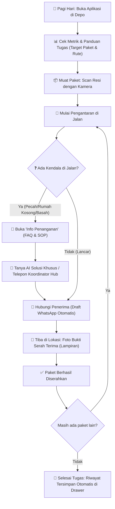

# Panduan Alur Kerja Aplikasi PARDALANI (Dongan Setia Kurir)

Dokumen ini menjelaskan **cara kerja dan alur aplikasi Pardalani** secara sederhana, runtut, dan mudah dipahami.

---

## 1. Apa itu Pardalani?

> **Pardalani** (bahasa Batak: *Teman Perjalanan*) adalah **aplikasi asisten kurir cerdas (AI Copilot)**.
> 
> Bayangkan aplikasi ini seperti **"teman yang duduk di samping kurir"** saat mengantar paket:
> - Mengatur rute tercepat agar bensin tidak boros dan tidak bolak-balik.
> - Membaca barcode resi dengan kamera tanpa perlu mengetik manual.
> - Membuatkan draf pesan WhatsApp ramah ke penerima secara otomatis.
> - Memberikan panduan SOP saat menghadapi masalah di lapangan (paket pecah, makanan beku, atau rumah penerima kosong).

---

## 2. Diagram Alur Pengantaran (Dari Pagi Sampai Selesai)

---

## 3. Langkah Demi Langkah (Alur Penggunaan Aplikasi)

### 🟢 Langkah 1: Persiapan di Depo (Pagi Hari)
1. Kurir membuka aplikasi **Pardalani** di HP.
2. Di bagian atas layar langsung terlihat ringkasan tugas hari ini:
   - Jumlah perhentian (*Contoh: 14 Titik*)
   - Jumlah paket (*Contoh: 28 Paket*)
   - Estimasi waktu selesai (*Contoh: 4.5 Jam*)
3. Muncul **Kartu Panduan (Welcome Carousel)** yang menampilkan 3 fitur andalan:
   - **Urutan Rute Tercepat** (klik `↗` untuk mulai susun rute).
   - **Pindai Resi Otomatis** (klik `↗` untuk langsung buka pemindai barcode).
   - **Dikte Suara Hands-free** (klik `↗` untuk bicara tanpa repot mengetik).
4. Tekan tombol hijau **"Mulai Bertugas Sekarang"** untuk masuk ke beranda kerja.

---

### 🟡 Langkah 2: Memindai Resi (Scan Barcode)
1. Kurir mengetuk tombol cepat **"Scan Label / Resi"** (atau ikon kamera di bagian bawah).
2. Kamera HP otomatis terbuka dengan jendela bidik dan laser pemindai.
3. Sorot barcode/QR code pada paket:
   - Data nomor resi, nama penerima, dan alamat langsung terbaca otomatis.
   - Kurir **tidak perlu mengetik** deretan angka resi yang panjang.

---

### 🔵 Langkah 3: Asisten AI di Perjalanan (Navigasi & Chat)
Saat kurir mengendarai motor atau mobil:
1. **Dikte Suara (Hands-Free):**
   - Kurir cukup menekan ikon **Mikrofon** dan berbicara:
     > *"Jalan Kenanga 4 lewat mana yang gak macet?"*
   - AI langsung membalas dengan petunjuk rute tercepat.
2. **Draft WhatsApp Otomatis:**
   - Cukup klik tombol **"Draft WhatsApp"**.
   - AI langsung membuatkan pesan sopan siap kirim, misalnya:
     > *"Halo Kak Rina, saya kurir Pardalani sedang menuju ke alamat Jl. Melati No. 12. Estimasi tiba 10 menit lagi. Mohon pastikan ada orang di rumah ya kak."*
   - Kurir tinggal klik kirim ke WhatsApp penerima.

---

### 🔴 Langkah 4: Menangani Kendala Lapangan (Info Penanganan & SOP)
Jika terjadi situasi tak terduga, kurir mengetuk tombol **"Info Penanganan"**:
1. **Pop-up FAQ Instan Muncul** dengan 4 kategori darurat:
   - **Paket Pecah Belah (Fragile):** Posisi harus paling atas tas, jangan ditindih barang berat.
   - **Makanan / Frozen Food:** Waktu kritis maksimal 2 jam, harus diantar paling awal.
   - **Penerima Tidak di Rumah:** Telepon 2x berselang 3 menit, boleh titip satpam berizin, atau jadwalkan antar ulang.
   - **Paket Rusak / Basah:** Wajib foto 4 sisi resi sebelum diserahkan agar kurir tidak terkena denda ganti rugi.
2. **Halaman Khusus SOP Lengkap:**
   - Jika butuh panduan resmi mendalam, klik **"Buka Halaman Khusus SOP Lengkap"**.
   - Tersedia tombol:
     - 💬 **"Tanyakan Solusi Khusus ke AI"** (otomatis konsultasi masalah ke asisten AI).
     - 📞 **"Hubungi Koordinator Hub"** (langsung melakukan panggilan telepon ke admin kantor).

---

### 🟣 Langkah 5: Penyerahan Paket & Bukti (Selesai)
1. Kurir sampai di alamat tujuan dan menyerahkan paket.
2. Jika perlu mengirim bukti serah terima atau lokasi:
   - Buka tombol tambah (`+`) di pojok kiri bawah:
     - 📷 **Album:** Mengambil/memilih foto bukti paket di depan rumah / pos satpam.
     - 📍 **Bagikan Lokasi:** Membagikan titik GPS Maps kurir saat ini.
     - 📄 **File:** Melampirkan surat jalan / manifest.
3. Catatan dan riwayat pengantaran hari ini otomatis tersimpan di menu **Sidebar Drawer** (garis tiga di kiri atas), bisa di-pin atau dicetak kembali jika diperlukan.

---

## 4. Penjelasan Tombol-Tombol Utama di Layar

| Bagian / Tombol | Ikon | Fungsinya bagi Kurir |
| :--- | :---: | :--- |
| **Horas, Kurir** | 🚚 | Banner status target tugas, jumlah paket, dan estimasi waktu. |
| **Optimasi Rute** | 🗺️ | Mengurutkan alamat pengantaran terdekat agar bensin hemat. |
| **Draft WhatsApp** | 💬 | Menghasilkan pesan konfirmasi otomatis ke penerima paket. |
| **Scan Label / Resi** | 📷 | Buka kamera live untuk scan barcode paket seketika. |
| **Info Penanganan** | 📦 | Buka pop-up FAQ & buku panduan SOP penanganan paket bermasalah. |
| **Input Pesan / Chat** | ✍️ | Tempat bertanya apa saja ke AI kurir (bisa teks atau suara). |
| **Tombol Lampiran (+)** | ➕ | Pilihan kirim foto album, dokumen file, atau bagikan lokasi GPS. |
| **Toggle Tema (Matahari/Bulan)** | ☀️/🌙 | Ganti Mode Terang (siang hari terik) atau Mode Gelap (malam hari). |
| **Menu Samping (Drawer)** | ☰ | Melihat riwayat percakapan hari ini, kemarin, dan sesi tersimpan. |

---

## 5. Ringkasan Arsitektur (Di Balik Layar)

Secara teknis, aplikasi ini dibangun dengan 3 lapisan sederhana:
1. **Frontend (Tampilan Aplikasi):** Menggunakan **React 19 + Tailwind CSS**, membuat animasi dan sentuhan layar terasa sangat cepat dan mulus.
2. **Mobile Container (Capacitor Android):** Mengubah tampilan web menjadi **file APK Android asli** (`Pardalani-v1.8.apk`) sehingga bisa mengakses kamera HP, getaran haptic, dan GPS.
3. **Backend API (Go Fiber + MongoDB + Redis):** Menangani database akun kurir, penyimpanan percakapan, dan koneksi server.

---

*Dokumen ini dibuat agar seluruh tim pengembang dan pengguna memahami alur kerja aplikasi Pardalani dengan jelas.*
